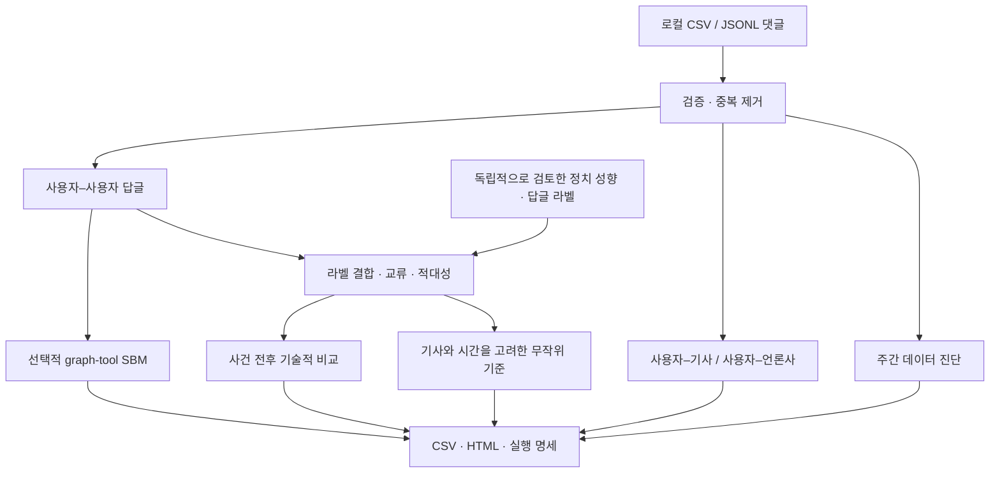

# M2 Research

네이버 뉴스 댓글의 참여 구조와 답글 관계를 비교하고, 정치 집단 간 교류·적대성을 주간 단위로 분석하는 파이프라인입니다.

## 실행

Python 3.10 이상, 저장소 루트에서 실행합니다. 기본 경로는 외부 패키지가 필요 없습니다.

```powershell
python -m unittest discover -s tests -v
python -m analysis.integration.pipeline --comments examples/comments.csv --users examples/users.csv --annotations examples/annotations.csv --events examples/events.csv --output data/output/demo --null-samples 100 --seed 42
```

`data/output/demo/report.html`을 브라우저에서 열어 집계 결과를 확인하세요. `examples/`의 댓글·사용자·라벨·사건은 **합성 예시**입니다. 실행마다 새 출력 폴더를 지정하며 기존 결과를 덮어쓰지 않습니다.

실제 자료는 라벨 없이 먼저 진단합니다:

```powershell
python -m analysis.integration.pipeline --comments data/raw/comments.jsonl --output data/output/diagnosis
```

생성된 `user_labels_template.csv`, `reply_labels_template.csv`를 로컬에서 검토·라벨링한 다음 `--users`, `--annotations`로 입력하여 새 폴더에 재실행합니다.

## 구조와 구현 상태



| 폴더 | 역할 / 상태 |
|---|---|
| `preprocessing` | CSV/JSONL, 기존 필드 별칭, ID·시간 검증, 동일 중복 제거 |
| `network/construction` | 답글 복원, 참여 네트워크 두 종류, 가중 방향 간선 |
| `nlp/dataset` | 주간 정치 성향, 답글 찬반·적대성 라벨 검증 |
| `network/metrics` | 방향별 교류, 라벨 커버리지, 적대성, 제약된 null model |
| `analysis/weekly` | 연결요소·참여 집중도·주간 분석 |
| `analysis/events` | 사건 주 제외, 전후 주간 평균의 기술적 비교 |
| `network/community` | graph-tool 설치 시 directed degree-corrected SBM |
| `visualization` | 외부 연결 없는 집계 HTML 보고서 |
| `collector`, `nlp/training`, `nlp/inference` | 후속 연결 지점. 라이브 수집 및 학습·자동 추론은 미구현 |

검증된 분류기가 없으므로 정치 성향을 키워드나 공감 수로 자동 판정하지 않습니다. **로컬 데이터에서 분석 결과까지 실행 가능한 파일럿**이며, 수집·모델 학습까지 완성된 운영 시스템은 아닙니다. 세 네트워크 중 주 분석 대상은 데이터 진단 후 결정합니다.

## 입력 계약

UTF-8 CSV 또는 한 줄 한 객체 JSONL. CSV ID는 문자열로 유지하세요.

| 표준 열 | 기존 별칭 | 규칙 |
|---|---|---|
| `publisher_id` | `oid` | 필수, 빈 문자열 불가 |
| `article_id` | `aid` | 필수 |
| `comment_id` | `commentNo` | 기사 내 고유 ID |
| `user_id` | `userIdNo` | 필수, 지속적인 익명 ID 권장 |
| `parent_id` | `parentCommentNo` | 루트는 공란/0/자신 ID, 답글은 부모 ID |
| `created_at` | `reg_time_utc` | UTC offset 포함 ISO 8601: `2024-12-03T10:00:00+09:00` |
| `text` | `contents` | 선택, 라벨링 문맥 |
| `reply_level` | `replyLevel` | 0=루트, 1/2=답글. 생략 시 부모 ID로 판단 |

루트 여부가 불명확하면 반드시 `reply_level`을 제공하세요. 실수형 ID, 잘못된 시간, 충돌하는 중복은 실행을 중단합니다. 댓글 키는 `(publisher_id, article_id, comment_id)`입니다. 추가 열은 허용하되 현재 분석에 사용하지 않습니다. 기사 원문·공감·비공감은 원본에 보존하세요.

- 사용자 라벨: `week,user_id,ideology` (`L/R/unknown`). `week`는 한국 시간 월요일 날짜. 이전 주 부모 작성자도 답글이 발생한 주의 라벨이 필요합니다.
- 답글 라벨: `publisher_id,article_id,comment_id,stance,hostility`. 부모 댓글에 대한 입장은 `support/oppose/unclear`, 적대성은 `yes/no/unknown`. **반대와 적대성을 구분**합니다.
- 사건: `event,date`. `--event-window 4`는 사건 주를 제외한 앞뒤 4개 달력 주를 비교합니다. 결측 주를 0으로 채우지 않으며 유효한 주 수를 제공합니다.

라벨 누락은 중립 또는 0이 아닙니다. 라벨 중복과 데이터에 없는 키는 오류입니다. 전체 기간 라벨의 자동 전파는 지원하지 않습니다.

## 결과

| 출력 | 내용 |
|---|---|
| `weekly.csv` | 참여·희소성·연결요소, L→L/L→R/R→L/R→R, 찬반·적대성, null 지표 |
| `reply_edges.csv` | 주간 발신자→수신자 답글 횟수 |
| `reply_issues.csv` | 누락 부모, 시간 역전, 자기 답글 등 제외 사유 |
| `user_article.csv`, `user_publisher.csv` | 댓글 횟수 가중 참여 관계 |
| `*_labels_template.csv` | 로컬 라벨링 양식. 답글 원문 포함 |
| `events.csv` | 선택적 사건 전후 평균·차이. 인과 효과가 아님 |
| `manifest.json` | 입력·코드 SHA-256, Git 상태, seed, 설정, 중복·제외 건수 |
| `report.html` | 원문과 사용자 ID를 제외한 오프라인 집계 보고서 |

월요일 시작, UTC+09:00 주간 구간입니다. 전체 작성자를 포함해 고립 노드를 계산합니다. 이전 주에만 글을 쓴 작성자가 이번 주 답글을 받으면 네트워크에 포함하고 `external_week_receivers`로 구분합니다. `authors`와 `network_nodes`의 분모 차이를 주의하세요. 연결요소는 weak components입니다. 미측정 값은 CSV 공란, HTML '미측정'입니다. 활동량 상위 1%는 작성자 수의 1%를 올림한 인원입니다.

## Null model의 범위

정치 성향이 양쪽 모두 알려진 간선에서만 수행합니다. 같은 **기사·주**에서 두 간선의 부모 댓글을 교환하여 발신/수신 횟수를 보존하고, 자기 사용자 연결과 미래 부모를 거부합니다. 원래 답글 시각을 유지합니다. burn-in 및 표본 간격은 각각 간선당 10회의 제안입니다. `--seed`, `--null-samples`로 재현합니다.

`cross_observed_expected`는 관측 교차 진영 간선 수 / null 평균입니다. 교환이 없거나 표본 분산이 0이면 비율을 제공하지 않습니다. 수락 횟수·수락률을 함께 확인하세요. 이 파일럿 MCMC는 상관된 표본을 만들며 혼합·수렴을 보장하지 않습니다. **유의확률, 실제 노출, 교류 회피의 증거로 해석할 수 없습니다.** 논문용 분석에는 다중 seed/체인, burn-in 민감도와 수렴 검증이 필요합니다. 화면 노출·댓글 정렬·의미상 응답 대상은 관측하지 않습니다.

## 선택적 SBM

graph-tool 사용이 가능한 Linux/WSL 환경에서 실행 명령에 `--sbm`을 추가합니다. 미설치 시 명확한 오류로 종료하며 다른 군집화로 대체하지 않습니다. `sbm_memberships.csv`, `sbm_models.csv`를 생성합니다. 답글 간선이 있는 사용자만 추론하며 정치 라벨을 입력으로 사용하지 않습니다. 주별 block 번호는 독립적입니다.

현재 환경에서 실제 graph-tool 추론은 검증하지 않았습니다. 기본 테스트는 표준 라이브러리 경로를 검증합니다. 연구에는 다중 초기화·블록 안정성·독립 라벨 대비 검증·시간별 블록 정합을 추가해야 합니다.

구현 참고: [minimize_blockmodel_dl](https://graph-tool.skewed.de/static/docs/stable/autosummary/graph_tool.inference.minimize_blockmodel_dl.html), [BlockState](https://graph-tool.skewed.de/static/docs/stable/autosummary/graph_tool.inference.BlockState.html).

## 다음 단계

1. 기존 자료로 답글 규모·누락을 확인하고 `parentCommentNo`가 실제 응답 대상을 나타내는지 표본을 점검합니다.
2. 라벨링 기준·평가자 일치도·보류 기준을 정하고 사용자/기사 단위로 독립 평가 자료를 확보합니다.
3. 검증된 분류기 출력을 라벨 계약에 맞춰 `nlp/inference`에 연결합니다.
4. 진단에 따라 주 분석 네트워크와 SBM 필요성을 결정합니다.
5. 수집 인터페이스, 대규모 처리, null 수렴 및 강건성 검증을 확장합니다.

현재 구현은 댓글과 라벨을 메모리에 적재합니다. 수천만 댓글에 사용하기 전 저장소 기반 인덱싱과 배치 처리로 확장해야 합니다. 실제 데이터·라벨·보고서는 Git 제외 경로인 `data/raw`, `data/intermediate`, `data/processed`, `data/output` 아래에 보관하세요.
